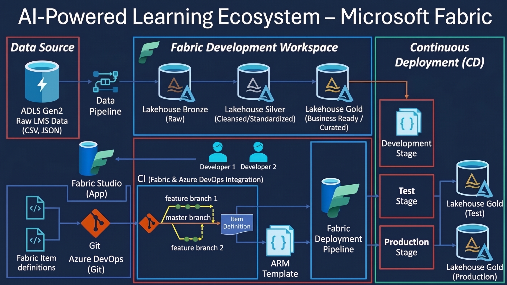
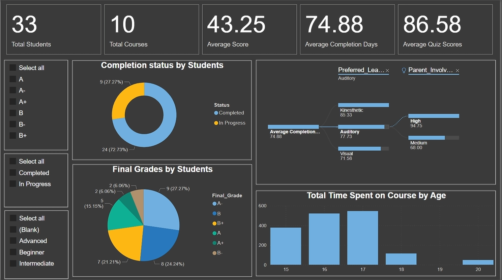

<h1 align="center">🤖 AI-Powered Learning Ecosystem – Microsoft Fabric</h1>

<h3 align="center">
  Building an Intelligent, Scalable Learning Analytics & Data Engineering Platform Using Microsoft Fabric
</h3>

  <b>Data Engineering | Medallion Architecture | Lakehouse | Incremental Data Loading | AI-Powered Analytics | CI/CD | Business Intelligence</b>

---

<h2>📌 Table of Contents</h2>

<ol>
  <li><a href="#project-overview">Project Overview</a></li>
  <li><a href="#business-problem">Business Problem</a></li>
  <li><a href="#proposed-solution">Proposed Solution</a></li>
  <li><a href="#project-objectives">Project Objectives</a></li>
  <li><a href="#technology-stack">Technology Stack</a></li>
  <li><a href="#data-sources">Data Sources</a></li>
  <li><a href="#system-architecture">System Architecture</a></li>
  <li><a href="#detailed-implementation">Detailed Implementation</a></li>
  <li><a href="#end-to-end-data-pipeline-workflow">End-to-End Data Pipeline Workflow</a></li>
  <li><a href="#medallion-architecture">Medallion Architecture</a></li>
  <li><a href="#incremental-data-loading">Incremental Data Loading – Daily UPSERT</a></li>
  <li><a href="#data-transformation">Data Transformation & Processing</a></li>
  <li><a href="#ai-powered-data-agent">AI-Powered Data Agent</a></li>
  <li><a href="#cicd-integration">CI/CD Integration – Azure DevOps</a></li>
  <li><a href="#fabric-deployment-pipeline">Fabric Deployment Pipeline</a></li>
  <li><a href="#learning-analytics-dashboard">Learning Analytics Dashboard</a></li>
  <li><a href="#key-business-metrics">Key Business Metrics</a></li>
  <li><a href="#challenges-and-solutions">Challenges and Solutions</a></li>
  <li><a href="#key-learnings">Key Learnings</a></li>
  <li><a href="#future-enhancements">Future Enhancements</a></li>
  <li><a href="#project-conclusion">Project Conclusion</a></li>
</ol>

---

<h2 id="project-overview">🚀 1. Project Overview</h2>

The <b>AI-Powered Learning Ecosystem – Microsoft Fabric</b> is an end-to-end data engineering and business intelligence project designed to transform raw Learning Management System (LMS) data into meaningful, actionable learning insights using Microsoft Fabric.

The platform integrates enterprise LMS data stored in Azure Data Lake Storage Gen2 (ADLS Gen2) and processes it through Microsoft Fabric using a modern Medallion Architecture.

The solution implements an automated data engineering workflow covering the complete data lifecycle, from raw data ingestion and storage to data cleansing, standardization, business-level transformation, and analytics-ready data delivery.

The platform follows the Bronze, Silver, and Gold Lakehouse architecture to ensure data quality, scalability, and structured data management.

To maintain up-to-date analytical datasets, the solution implements <b>daily incremental data loading using join-based matching and UPSERT operations</b>. New records are inserted, while existing records are updated, avoiding unnecessary full data reloads.

Additionally, the project integrates an <b>AI-powered Data Agent</b> that enables business users to interact with enterprise learning data using natural language and receive intelligent, data-driven answers without requiring SQL expertise.

The development and deployment lifecycle is managed using Azure DevOps and Microsoft Fabric CI/CD capabilities, enabling version control, collaborative development, and promotion of Fabric artifacts across Development, Test, and Production environments.

<h3>Core Technologies</h3>

<ul>
  <li>Microsoft Fabric</li>
  <li>OneLake & Fabric Lakehouse</li>
  <li>Azure Data Lake Storage Gen2</li>
  <li>Fabric Data Pipelines</li>
  <li>Medallion Architecture</li>
  <li>Incremental Data Loading</li>
  <li>UPSERT Operations</li>
  <li>AI-Powered Data Agent</li>
  <li>Azure DevOps & Git Integration</li>
  <li>Fabric Deployment Pipelines</li>
  <li>Power BI</li>
</ul>

<h3>🎯 Project Goal</h3>

To build a scalable, AI-powered learning analytics ecosystem that transforms raw LMS data into reliable business intelligence, democratizes data access through natural-language interactions, maintains up-to-date datasets through automated incremental loading, and automates the development and deployment lifecycle using Microsoft Fabric and Azure DevOps.

---

<h2 id="business-problem">💼 2. Business Problem</h2>

Modern learning platforms generate large volumes of data related to students, courses, assessments, quiz scores, completion status, learning preferences, and learning engagement.

However, transforming this information into meaningful business insights presents several challenges:

<ul>
  <li><b>Data Fragmentation:</b> Learning data may be stored across multiple files, systems, and formats.</li>
  <li><b>Manual Data Processing:</b> Extracting, cleaning, and preparing LMS datasets requires repetitive processing.</li>
  <li><b>Data Quality Issues:</b> Missing values, inconsistent formats, and duplicate records can affect analytical accuracy.</li>
  <li><b>Full Data Reload Overhead:</b> Reprocessing entire datasets every day can increase processing time and resource consumption.</li>
  <li><b>Limited Data Accessibility:</b> Business users often depend on technical teams to retrieve information using SQL.</li>
  <li><b>Delayed Decision-Making:</b> Manual reporting can slow down the identification of learning performance trends.</li>
  <li><b>Limited Learning Insights:</b> Understanding relationships between learning preferences, parental involvement, course completion, and student performance can be challenging.</li>
  <li><b>Deployment Complexity:</b> Managing Fabric development artifacts across multiple environments requires structured version control and deployment processes.</li>
  <li><b>Scalability Requirements:</b> The platform needs an architecture that supports future data growth and additional analytical capabilities.</li>
</ul>

<h3>Business Requirements</h3>

<ol>
  <li>Ingest LMS data from ADLS Gen2.</li>
  <li>Establish a centralized data platform using Microsoft Fabric and OneLake.</li>
  <li>Implement Bronze, Silver, and Gold Lakehouse layers.</li>
  <li>Clean, standardize, and transform LMS datasets.</li>
  <li>Implement daily incremental loading using UPSERT operations.</li>
  <li>Develop business-ready datasets for learning analytics.</li>
  <li>Build interactive dashboards to monitor student and course performance.</li>
  <li>Enable natural-language data access through an AI-powered Data Agent.</li>
  <li>Implement Git-based version control using Azure DevOps.</li>
  <li>Automate the promotion of Fabric artifacts across Development, Test, and Production environments.</li>
</ol>

---

<h2 id="proposed-solution">💡 3. Proposed Solution</h2>

To address these challenges, this project implements an end-to-end AI-powered data platform using Microsoft Fabric.

<h3>Solution Highlights</h3>

<ul>
  <li>Automated LMS data ingestion from ADLS Gen2 using Fabric Data Pipelines.</li>
  <li>Centralized data management using Microsoft Fabric and OneLake.</li>
  <li>Implementation of the Medallion Architecture.</li>
  <li>Bronze Lakehouse for storing raw LMS data.</li>
  <li>Silver Lakehouse for cleansing and standardizing datasets.</li>
  <li>Gold Lakehouse for curated, business-ready analytical data.</li>
  <li>Daily incremental data loading using join-based matching and UPSERT operations.</li>
  <li>Automatic insertion of new records and updating of existing records.</li>
  <li>AI-powered Data Agent for natural-language business queries.</li>
  <li>Interactive learning analytics dashboard using Power BI.</li>
  <li>Git integration with Azure DevOps.</li>
  <li>Collaborative development using feature branches and a master branch.</li>
  <li>Fabric item definitions and ARM template-based deployment configuration.</li>
  <li>Fabric Deployment Pipeline for Development, Test, and Production environments.</li>
</ul>

---

<h2 id="project-objectives">🎯 4. Project Objectives</h2>

<table>
  <thead>
    <tr>
      <th>Objective</th>
      <th>Description</th>
    </tr>
  </thead>
  <tbody>
    <tr><td>Data Ingestion</td><td>Ingest LMS datasets from ADLS Gen2.</td></tr>
    <tr><td>Centralized Storage</td><td>Use Microsoft Fabric and OneLake.</td></tr>
    <tr><td>Data Architecture</td><td>Implement Bronze, Silver, and Gold layers.</td></tr>
    <tr><td>Data Transformation</td><td>Clean, standardize, and transform LMS data.</td></tr>
    <tr><td>Incremental Processing</td><td>Perform daily incremental loading using UPSERT.</td></tr>
    <tr><td>Data Integration</td><td>Prepare structured learning analytics datasets.</td></tr>
    <tr><td>Business Intelligence</td><td>Develop interactive learning dashboards.</td></tr>
    <tr><td>AI Integration</td><td>Enable natural-language data interaction.</td></tr>
    <tr><td>Version Control</td><td>Integrate Fabric development with Azure DevOps Git.</td></tr>
    <tr><td>CI/CD Automation</td><td>Establish structured development and deployment workflows.</td></tr>
    <tr><td>Scalability</td><td>Build an extensible enterprise learning analytics platform.</td></tr>
  </tbody>
</table>

---

<h2 id="technology-stack">🛠 5. Technology Stack</h2>

<table>
  <thead>
    <tr>
      <th>Technology</th>
      <th>Purpose</th>
    </tr>
  </thead>
  <tbody>
    <tr><td>Microsoft Fabric</td><td>Unified data engineering and analytics platform.</td></tr>
    <tr><td>OneLake</td><td>Centralized data storage.</td></tr>
    <tr><td>Fabric Lakehouse</td><td>Structured storage and analytical data management.</td></tr>
    <tr><td>Azure Data Lake Storage Gen2</td><td>Source LMS data storage.</td></tr>
    <tr><td>Fabric Data Pipelines</td><td>Data ingestion and orchestration.</td></tr>
    <tr><td>Medallion Architecture</td><td>Layered data processing.</td></tr>
    <tr><td>Bronze Lakehouse</td><td>Raw data storage.</td></tr>
    <tr><td>Silver Lakehouse</td><td>Cleansed and standardized data.</td></tr>
    <tr><td>Gold Lakehouse</td><td>Business-ready analytical data.</td></tr>
    <tr><td>Incremental Data Loading</td><td>Daily processing of new and changed records.</td></tr>
    <tr><td>UPSERT Operations</td><td>Insert new records and update existing records.</td></tr>
    <tr><td>AI-Powered Data Agent</td><td>Natural-language interaction with learning data.</td></tr>
    <tr><td>Power BI</td><td>Interactive analytics and visualization.</td></tr>
    <tr><td>Azure DevOps</td><td>Source control and CI/CD integration.</td></tr>
    <tr><td>Git</td><td>Version control and collaborative development.</td></tr>
    <tr><td>ARM Templates</td><td>Deployment configuration.</td></tr>
    <tr><td>Fabric Deployment Pipelines</td><td>Environment-based artifact promotion.</td></tr>
  </tbody>
</table>

---

<h2 id="data-sources">📂 6. Data Sources</h2>

<h3>Learning Management System (LMS) Data</h3>

<b>Source:</b> Azure Data Lake Storage Gen2 (ADLS Gen2)

The primary data source consists of raw learning management system datasets stored in cloud storage.

<h4>Supported Source Formats</h4>

<ul>
  <li>CSV</li>
  <li>JSON</li>
</ul>

<h4>Learning Data Domains</h4>

<ul>
  <li>Student information</li>
  <li>Course information</li>
  <li>Student assessment results</li>
  <li>Quiz scores</li>
  <li>Course completion status</li>
  <li>Learning performance</li>
  <li>Learning preferences</li>
  <li>Parent involvement</li>
  <li>Student age and learning activity</li>
</ul>

<b>Integration Method:</b> Microsoft Fabric Data Pipeline connected to ADLS Gen2.

<h3>Business Purpose</h3>

The LMS datasets provide the foundation for:

<ul>
  <li>Monitoring student learning performance.</li>
  <li>Analyzing course completion rates.</li>
  <li>Evaluating assessment and quiz results.</li>
  <li>Understanding learning preferences.</li>
  <li>Identifying relationships between parental involvement and learning outcomes.</li>
  <li>Measuring learning activity and time spent on courses.</li>
  <li>Supporting data-driven educational decisions.</li>
</ul>

---

<h2 id="system-architecture">🏗 7. System Architecture</h2>

The project follows a modern Microsoft Fabric architecture that combines data ingestion, Lakehouse processing, AI-powered analytics, incremental data processing, and automated deployment.

<h3>Architecture Diagram</h3>

  

<h3>Architecture Components</h3>

<table>
  <thead>
    <tr>
      <th>Layer</th>
      <th>Technology</th>
      <th>Responsibility</th>
    </tr>
  </thead>
  <tbody>
    <tr><td>Data Source</td><td>ADLS Gen2</td><td>Stores raw LMS datasets.</td></tr>
    <tr><td>Data Ingestion</td><td>Fabric Data Pipeline</td><td>Transfers and orchestrates source data.</td></tr>
    <tr><td>Storage</td><td>Microsoft OneLake</td><td>Centralized data storage.</td></tr>
    <tr><td>Bronze</td><td>Fabric Lakehouse</td><td>Raw LMS data.</td></tr>
    <tr><td>Silver</td><td>Fabric Lakehouse</td><td>Cleansed and standardized data.</td></tr>
    <tr><td>Gold</td><td>Fabric Lakehouse</td><td>Curated business-ready datasets.</td></tr>
    <tr><td>Incremental Processing</td><td>Join-based UPSERT</td><td>Inserts new records and updates existing records.</td></tr>
    <tr><td>AI Analytics</td><td>AI-Powered Data Agent</td><td>Natural-language data interaction.</td></tr>
    <tr><td>Visualization</td><td>Power BI</td><td>Learning analytics dashboard.</td></tr>
    <tr><td>Source Control</td><td>Azure DevOps Git</td><td>Version control and collaboration.</td></tr>
    <tr><td>CI/CD</td><td>Fabric and Azure DevOps</td><td>Development lifecycle management.</td></tr>
    <tr><td>Deployment</td><td>Fabric Deployment Pipeline</td><td>Environment-based deployment.</td></tr>
  </tbody>
</table>

<h3>Architecture Design Principles</h3>

<ul>
  <li>Layered data processing.</li>
  <li>Centralized data management.</li>
  <li>Daily incremental data processing.</li>
  <li>Separation of development and production environments.</li>
  <li>Reusable data engineering components.</li>
  <li>Version-controlled development.</li>
  <li>Automated deployment workflows.</li>
  <li>AI-enabled data accessibility.</li>
  <li>Scalable analytical architecture.</li>
</ul>

---

<h2 id="detailed-implementation">⚙️ 8. Detailed Implementation</h2>

<h3>8.1 Data Ingestion – Azure Data Lake Storage Gen2</h3>

Azure Data Lake Storage Gen2 acts as the source storage platform for the learning management datasets.

<h4>Implementation</h4>

<ul>
  <li>Configured ADLS Gen2 as the source data platform.</li>
  <li>Organized raw LMS datasets in cloud storage.</li>
  <li>Used Microsoft Fabric Data Pipelines to connect to source data.</li>
  <li>Established the ingestion workflow into the Fabric environment.</li>
  <li>Prepared source datasets for subsequent Lakehouse processing.</li>
</ul>

<h3>8.2 Data Ingestion and Orchestration – Microsoft Fabric</h3>

Microsoft Fabric Data Pipelines are used to orchestrate the movement of LMS data into the Lakehouse architecture.

<h4>Key Responsibilities</h4>

<ul>
  <li>Connect to ADLS Gen2.</li>
  <li>Access raw LMS datasets.</li>
  <li>Orchestrate data movement.</li>
  <li>Establish the ingestion workflow.</li>
  <li>Support downstream Lakehouse processing.</li>
</ul>

<h3>8.3 Data Storage – Microsoft OneLake</h3>

Microsoft OneLake provides the unified storage foundation for the Fabric ecosystem.

<h4>Key Features</h4>

<ul>
  <li>Unified data storage.</li>
  <li>Centralized data management.</li>
  <li>Integration with Fabric Lakehouse.</li>
  <li>Support for analytical workloads.</li>
  <li>Simplified data accessibility across Fabric experiences.</li>
</ul>

<h3>8.4 Bronze Lakehouse – Raw Data Layer</h3>

The Bronze Lakehouse represents the initial storage layer of the Medallion Architecture.
It stores raw LMS data ingested from ADLS Gen2.

<ul>
  <li>Store original source datasets.</li>
  <li>Preserve source information.</li>
  <li>Maintain raw data structures.</li>
  <li>Provide the foundation for downstream transformations.</li>
  <li>Support historical data processing and reprocessing.</li>
</ul>

<h3>8.5 Silver Lakehouse – Cleansed and Standardized Data</h3>

The Silver Lakehouse represents the intermediate transformation layer.
Data from the Bronze layer is processed to improve quality, consistency, and usability.

<ul>
  <li>Data cleansing.</li>
  <li>Schema standardization.</li>
  <li>Data type validation.</li>
  <li>Missing value handling.</li>
  <li>Duplicate record handling.</li>
  <li>Column standardization.</li>
  <li>Data consistency improvements.</li>
</ul>

<h3>8.6 Gold Lakehouse – Business-Ready Data</h3>

The Gold Lakehouse represents the final analytical layer.
It contains curated datasets prepared for business intelligence, learning analytics, and AI-powered data interaction.

<ul>
  <li>Prepare business-ready datasets.</li>
  <li>Organize analytical information.</li>
  <li>Support student performance analysis.</li>
  <li>Support course completion analysis.</li>
  <li>Prepare datasets for dashboard reporting.</li>
  <li>Provide structured data for the AI-powered Data Agent.</li>
</ul>

---

<h2 id="end-to-end-data-pipeline-workflow">🔄 9. End-to-End Data Pipeline Workflow</h2>

The complete data processing workflow follows the Medallion Architecture and incorporates daily incremental data loading.

<h3>Pipeline Execution Sequence</h3>

<pre>
       ┌─────────────────────────────┐
       │        DATA SOURCES          │
       │          ADLS Gen2           │
       │        Raw LMS Data          │
       │         CSV / JSON           │
       └──────────────┬──────────────┘
                      │
                      ▼
       ┌─────────────────────────────┐
       │    FABRIC DATA PIPELINE     │
       │     Data Ingestion          │
       │     Data Orchestration      │
       └──────────────┬──────────────┘
                      │
                      ▼
       ┌─────────────────────────────┐
       │      BRONZE LAKEHOUSE       │
       │          Raw Data           │
       └──────────────┬──────────────┘
                      │
                      ▼
       ┌─────────────────────────────┐
       │      SILVER LAKEHOUSE       │
       │     Cleansing               │
       │     Standardization         │
       │     Data Quality            │
       └──────────────┬──────────────┘
                      │
                      ▼
       ┌─────────────────────────────┐
       │       GOLD LAKEHOUSE        │
       │      Curated Data           │
       │    Business-Ready Data      │
       └──────────────┬──────────────┘
                      │
                      ▼
       ┌─────────────────────────────┐
       │    INCREMENTAL PROCESSING   │
       │     Daily Execution         │
       │     Join-Based Matching     │
       │     UPSERT Operations       │
       │                             │
       │     INSERT New Records      │
       │     UPDATE Existing Records │
       └──────────────┬──────────────┘
                      │
             ┌────────┴────────┐
             │                 │
             ▼                 ▼
      ┌──────────────┐  ┌────────────────┐
      │   POWER BI   │  │  AI DATA AGENT │
      │              │  │                │
      │  Learning    │  │ Natural        │
      │  Analytics   │  │ Language       │
      └──────────────┘  └────────────────┘
</pre>

<h3>Workflow Summary</h3>

<ol>
  <li>Raw LMS datasets are stored in ADLS Gen2.</li>
  <li>Fabric Data Pipelines orchestrate data ingestion.</li>
  <li>Raw data is loaded into the Bronze Lakehouse.</li>
  <li>Data is cleansed and standardized in the Silver Lakehouse.</li>
  <li>Business transformations and curation are performed for the Gold Lakehouse.</li>
  <li>Incremental processing identifies new and existing records through join-based matching.</li>
  <li>UPSERT operations insert new records and update existing records.</li>
  <li>The incremental workflow runs daily to keep the analytical data up to date.</li>
  <li>Curated datasets are available for Power BI reporting and AI-powered data interaction.</li>
</ol>

---

<h2 id="medallion-architecture">🥉 10. Medallion Architecture</h2>

The project follows the Medallion Architecture to organize data into three logical processing layers.

<table>
  <thead>
    <tr>
      <th>Layer</th>
      <th>Purpose</th>
      <th>Processing</th>
    </tr>
  </thead>
  <tbody>
    <tr>
      <td>🥉 Bronze</td>
      <td>Raw data storage</td>
      <td>Preserve original source data.</td>
    </tr>
    <tr>
      <td>🥈 Silver</td>
      <td>Cleansed data</td>
      <td>Clean, standardize, validate, and remove duplicates.</td>
    </tr>
    <tr>
      <td>🥇 Gold</td>
      <td>Curated data</td>
      <td>Business transformations, aggregations, and analytical datasets.</td>
    </tr>
  </tbody>
</table>

<h3>🥉 Bronze Layer – Raw Data</h3>

The Bronze layer stores the original LMS datasets ingested from ADLS Gen2.

<ul>
  <li>Raw student information.</li>
  <li>Course datasets.</li>
  <li>Assessment records.</li>
  <li>Quiz information.</li>
  <li>Learning activity data.</li>
  <li>Original CSV and JSON records.</li>
</ul>

<b>Purpose:</b> Preserve source data and provide a reliable foundation for downstream transformations.

<h3>🥈 Silver Layer – Cleansed Data</h3>

<ul>
  <li>Data type standardization.</li>
  <li>Missing value handling.</li>
  <li>Duplicate record management.</li>
  <li>Schema validation.</li>
  <li>Column standardization.</li>
  <li>Data cleansing.</li>
  <li>Data consistency checks.</li>
</ul>

<b>Purpose:</b> Improve data quality and ensure consistency across learning datasets.

<h3>🥇 Gold Layer – Curated Data</h3>

<ul>
  <li>Student performance datasets.</li>
  <li>Course completion information.</li>
  <li>Final grade information.</li>
  <li>Quiz score metrics.</li>
  <li>Learning preference analysis.</li>
  <li>Parent involvement analysis.</li>
  <li>Student age-based learning activity.</li>
  <li>Aggregated learning analytics.</li>
</ul>

<b>Purpose:</b> Provide structured, trusted data for Power BI dashboards and AI-powered business intelligence.

---

<h2 id="incremental-data-loading">🔁 11. Incremental Data Loading – Daily UPSERT</h2>

A key engineering capability implemented in this project is <b>automated daily incremental data loading</b>.

Instead of reprocessing and reloading the entire dataset every day, the platform uses join-based matching and UPSERT operations to identify new and existing records and apply the appropriate changes.

<h3>Incremental Loading Strategy</h3>

<ul>
  <li>Daily scheduled execution.</li>
  <li>Join-based record matching.</li>
  <li>UPSERT operations.</li>
  <li>Automatic insertion of new records.</li>
  <li>Automatic updating of existing records.</li>
</ul>

<h3>How It Works</h3>

<h4>Step 1 – Daily Data Ingestion</h4>

The pipeline retrieves the latest LMS data from the source and makes it available for incremental processing.

<h4>Step 2 – Record Matching Using Joins</h4>

Source records are matched against existing target records using the relevant matching keys.
This matching process helps identify records that already exist and records that need to be inserted.

<h4>Step 3 – UPSERT Operation</h4>

<table>
  <thead>
    <tr>
      <th>Record Condition</th>
      <th>Operation</th>
      <th>Result</th>
    </tr>
  </thead>
  <tbody>
    <tr><td>New record</td><td>INSERT</td><td>Adds a new record to the target.</td></tr>
    <tr><td>Existing record</td><td>UPDATE</td><td>Updates the existing target record.</td></tr>
    <tr><td>Existing unchanged record</td><td>No unnecessary update</td><td>Retains the existing target information.</td></tr>
  </tbody>
</table>

<h4>Step 4 – Daily Synchronization</h4>

The process runs every day, keeping the target data updated as new LMS information becomes available.

<h3>Incremental Loading Workflow</h3>

<pre>
       DAILY PIPELINE EXECUTION
                  |
                  ▼
        READ SOURCE LMS DATA
                  |
                  ▼
         READ TARGET DATA
                  |
                  ▼
        JOIN-BASED MATCHING
                  |
                  ▼
        IDENTIFY RECORDS
                  |
          ┌───────┴────────┐
          │                │
          ▼                ▼
     NEW RECORDS      EXISTING RECORDS
          │                │
          ▼                ▼
        INSERT           UPDATE
          │                │
          └───────┬────────┘
                  |
                  ▼
        UPDATED TARGET DATA
                  |
                  ▼
       DAILY DATA SYNCHRONIZATION
</pre>

<h3>Business and Technical Benefits</h3>

<ul>
  <li><b>Reduced Processing Overhead:</b> Avoids unnecessary full data reloads.</li>
  <li><b>Improved Efficiency:</b> Processes new and existing records through incremental operations.</li>
  <li><b>Data Consistency:</b> Keeps target datasets aligned with the latest source information.</li>
  <li><b>Automated Updates:</b> Existing records are updated automatically.</li>
  <li><b>New Record Handling:</b> Newly arriving records are inserted into the target.</li>
  <li><b>Daily Data Freshness:</b> Scheduled execution maintains up-to-date analytical datasets.</li>
  <li><b>Scalability:</b> Establishes an efficient approach for managing growing LMS datasets.</li>
</ul>

---

<h2 id="data-transformation">🧮 12. Data Transformation & Processing</h2>

Data transformation is an essential component of the learning analytics platform.
The project uses the Silver and Gold layers to transform raw LMS information into structured and meaningful analytical datasets.

<h3>Transformation Objectives</h3>

<table>
  <thead>
    <tr>
      <th>Transformation</th>
      <th>Business Purpose</th>
    </tr>
  </thead>
  <tbody>
    <tr><td>Data Cleansing</td><td>Improve source data quality.</td></tr>
    <tr><td>Data Standardization</td><td>Maintain consistent formats.</td></tr>
    <tr><td>Missing Value Handling</td><td>Improve analytical reliability.</td></tr>
    <tr><td>Duplicate Management</td><td>Avoid duplicate analytical records.</td></tr>
    <tr><td>Data Aggregation</td><td>Generate meaningful KPIs.</td></tr>
    <tr><td>Performance Analysis</td><td>Understand student outcomes.</td></tr>
    <tr><td>Completion Analysis</td><td>Monitor learning progress.</td></tr>
    <tr><td>Learning Preference Analysis</td><td>Understand different learning styles.</td></tr>
    <tr><td>Incremental UPSERT</td><td>Insert new and update existing records.</td></tr>
  </tbody>
</table>

<h3>Analytical Data Domains</h3>

<ol>
  <li>Student Performance Analytics.</li>
  <li>Course Completion Analytics.</li>
  <li>Final Grade Distribution.</li>
  <li>Quiz Performance Analysis.</li>
  <li>Learning Preference Analysis.</li>
  <li>Parent Involvement Analysis.</li>
  <li>Age-Based Learning Activity Analysis.</li>
</ol>

---

<h2 id="ai-powered-data-agent">🤖 13. AI-Powered Data Agent</h2>

One of the major capabilities of this project is the integration of an AI-powered Data Agent.

The Data Agent provides a natural-language interface that enables business users to interact with enterprise LMS data without requiring advanced SQL knowledge.

Traditional data analysis often requires users to understand database schemas, write SQL queries, and depend on technical teams to retrieve business information.

The AI-powered Data Agent simplifies this process by enabling users to ask questions in everyday language and receive intelligent, data-driven answers.

<h3>Key Capabilities</h3>

<ul>
  <li>Natural-language interaction with learning datasets.</li>
  <li>Simplified access to enterprise LMS information.</li>
  <li>Business-oriented analytical questions.</li>
  <li>Reduced dependency on manual SQL queries.</li>
  <li>Faster access to learning insights.</li>
  <li>Improved data accessibility for non-technical users.</li>
</ul>

<h3>Example Business Questions</h3>

<ul>
  <li>How many students are enrolled in the learning platform?</li>
  <li>What is the average student performance score?</li>
  <li>How many students have completed their courses?</li>
  <li>Which learning preference has the highest average completion time?</li>
  <li>What is the average quiz score?</li>
  <li>How does parent involvement relate to student performance?</li>
  <li>What are the final grade distributions?</li>
  <li>Which age group spends the most time on courses?</li>
</ul>

<h3>Business Value</h3>

The AI-powered Data Agent helps democratize enterprise data access by allowing users to explore learning information through natural-language interactions.
It reduces the technical barrier to analytics and supports faster, more accessible, data-driven decision-making.

---

<h2 id="cicd-integration">🔄 14. CI/CD Integration – Azure DevOps</h2>

A major component of this project is the integration of Microsoft Fabric with Azure DevOps to establish a structured development and version control workflow.

Azure DevOps Git provides source control for Fabric item definitions and supports collaborative development.

<h3>Development Workflow</h3>

<ul>
  <li>Azure DevOps Git repository.</li>
  <li>Microsoft Fabric Git integration.</li>
  <li>Fabric item definitions.</li>
  <li>Feature branch development.</li>
  <li>Master branch integration.</li>
  <li>Collaborative development.</li>
  <li>ARM template generation.</li>
  <li>Fabric deployment integration.</li>
</ul>

<h3>Git Branching Strategy</h3>

<pre>
                 MASTER BRANCH
                       |
             ┌─────────┴─────────┐
             |                   |
             ▼                   ▼
       FEATURE BRANCH 1    FEATURE BRANCH 2
             |                   |
             ▼                   ▼
        DEVELOPER 1         DEVELOPER 2
             |                   |
             ▼                   ▼
        DEVELOPMENT         DEVELOPMENT
             |                   |
             └─────────┬─────────┘
                       |
                       ▼
                MASTER BRANCH
                       |
                       ▼
                ITEM DEFINITION
                       |
                       ▼
                 ARM TEMPLATE
                       |
                       ▼
               FABRIC DEPLOYMENT
</pre>

<h3>CI/CD Responsibilities</h3>

<table>
  <thead>
    <tr>
      <th>Component</th>
      <th>Responsibility</th>
    </tr>
  </thead>
  <tbody>
    <tr><td>Azure DevOps</td><td>Centralized source control.</td></tr>
    <tr><td>Git Repository</td><td>Store version-controlled artifacts.</td></tr>
    <tr><td>Feature Branches</td><td>Isolate individual development work.</td></tr>
    <tr><td>Master Branch</td><td>Maintain integrated development artifacts.</td></tr>
    <tr><td>Fabric Git Integration</td><td>Synchronize Fabric items with Git.</td></tr>
    <tr><td>Item Definitions</td><td>Represent Fabric artifacts.</td></tr>
    <tr><td>ARM Templates</td><td>Support deployment configuration.</td></tr>
    <tr><td>Deployment Pipeline</td><td>Promote artifacts across environments.</td></tr>
  </tbody>
</table>

<h3>Benefits of CI/CD Integration</h3>

<ul>
  <li>Collaborative development.</li>
  <li>Version-controlled Fabric artifacts.</li>
  <li>Improved change management.</li>
  <li>Reduced manual deployment effort.</li>
  <li>Consistent deployment workflows.</li>
  <li>Better development lifecycle management.</li>
  <li>Improved maintainability and scalability.</li>
</ul>

---

<h2 id="fabric-deployment-pipeline">🚀 15. Fabric Deployment Pipeline</h2>

Microsoft Fabric Deployment Pipelines are used to manage the promotion of Fabric artifacts across different environments.

<h3>1. Development Stage</h3>

<ul>
  <li>Develop Fabric items.</li>
  <li>Implement changes.</li>
  <li>Integrate Git-managed artifacts.</li>
  <li>Prepare deployment configurations.</li>
  <li>Validate development changes.</li>
</ul>

<h3>2. Test Stage</h3>

<ul>
  <li>Validate deployment results.</li>
  <li>Test Fabric artifacts.</li>
  <li>Verify data processing workflows.</li>
  <li>Identify deployment issues.</li>
  <li>Confirm readiness for production.</li>
</ul>

<h3>3. Production Stage</h3>

<ul>
  <li>Host production-ready Fabric artifacts.</li>
  <li>Support business reporting.</li>
  <li>Provide stable analytical datasets.</li>
  <li>Maintain the production learning analytics environment.</li>
</ul>

<h3>Deployment Workflow</h3>

<pre>
       AZURE DEVOPS / GIT
                |
                ▼
       FABRIC DEVELOPMENT
                |
                ▼
        ITEM DEFINITIONS
                |
                ▼
          ARM TEMPLATE
                |
                ▼
     FABRIC DEPLOYMENT PIPELINE
                |
                ▼
             TEST
                |
                ▼
           VALIDATION
                |
                ▼
           PRODUCTION
                |
                ▼
       PRODUCTION LAKEHOUSE
                |
                ▼
       BUSINESS ANALYTICS
</pre>

<h3>Deployment Benefits</h3>

<ul>
  <li>Structured environment management.</li>
  <li>Controlled promotion of Fabric artifacts.</li>
  <li>Reduced deployment inconsistencies.</li>
  <li>Improved release management.</li>
  <li>Separation of development and production workloads.</li>
  <li>Better collaboration between development teams.</li>
</ul>

---

<h2 id="learning-analytics-dashboard">📊 16. Learning Analytics Dashboard</h2>

Microsoft Power BI is used to visualize the curated learning datasets and provide an interactive view of student and course performance.

The dashboard transforms the Gold Lakehouse analytical data into meaningful business insights.

<h3>Dashboard Screenshot</h3>

  

<h3>1. Key Performance Indicators (KPIs)</h3>

<table>
  <thead>
    <tr>
      <th>KPI</th>
      <th>Dashboard Value</th>
    </tr>
  </thead>
  <tbody>
    <tr><td>Total Students</td><td>33</td></tr>
    <tr><td>Total Courses</td><td>10</td></tr>
    <tr><td>Average Score</td><td>43.25</td></tr>
    <tr><td>Average Completion Days</td><td>74.88</td></tr>
    <tr><td>Average Quiz Scores</td><td>86.58</td></tr>
  </tbody>
</table>

<h3>2. Completion Status by Students</h3>

<table>
  <thead>
    <tr>
      <th>Completion Status</th>
      <th>Students</th>
      <th>Percentage</th>
    </tr>
  </thead>
  <tbody>
    <tr><td>Completed</td><td>24</td><td>72.73%</td></tr>
    <tr><td>In Progress</td><td>9</td><td>27.27%</td></tr>
    <tr><td><b>Total</b></td><td><b>33</b></td><td><b>100%</b></td></tr>
  </tbody>
</table>

<b>Business Insight:</b> Approximately 72.73% of students have completed their learning activities, while 27.27% remain in progress.

<h3>3. Final Grades by Students</h3>

<table>
  <thead>
    <tr>
      <th>Final Grade</th>
      <th>Students</th>
      <th>Percentage</th>
    </tr>
  </thead>
  <tbody>
    <tr><td>A-</td><td>9</td><td>27.27%</td></tr>
    <tr><td>B</td><td>8</td><td>24.24%</td></tr>
    <tr><td>B+</td><td>7</td><td>21.21%</td></tr>
    <tr><td>A</td><td>5</td><td>15.15%</td></tr>
    <tr><td>A+</td><td>2</td><td>6.06%</td></tr>
    <tr><td>B-</td><td>2</td><td>6.06%</td></tr>
    <tr><td><b>Total</b></td><td><b>33</b></td><td><b>100%</b></td></tr>
  </tbody>
</table>

<b>Business Insight:</b> The grade distribution provides an overview of student achievement and helps identify overall academic performance patterns.

<h3>4. Learning Preferences and Parent Involvement</h3>

<h4>Average Completion Days by Learning Preference</h4>

<table>
  <thead>
    <tr>
      <th>Learning Preference</th>
      <th>Average Completion Days</th>
    </tr>
  </thead>
  <tbody>
    <tr><td>Kinesthetic</td><td>85.33</td></tr>
    <tr><td>Auditory</td><td>77.73</td></tr>
    <tr><td>Visual</td><td>71.58</td></tr>
  </tbody>
</table>

<h4>Average Completion Days by Parent Involvement</h4>

<table>
  <thead>
    <tr>
      <th>Parent Involvement</th>
      <th>Average Completion Days</th>
    </tr>
  </thead>
  <tbody>
    <tr><td>High</td><td>94.75</td></tr>
    <tr><td>Medium</td><td>68.00</td></tr>
  </tbody>
</table>

<b>Business Insight:</b> This analysis helps stakeholders explore differences in learning completion patterns across learning preferences and parental involvement categories.

<h3>5. Total Time Spent on Course by Age</h3>

A column chart visualizes total time spent on courses across different student age groups, ranging from 15 to 20 years.

<b>Business Insight:</b> Age-based learning activity analysis helps identify differences in course engagement and time spent across student age groups.

<h3>Dashboard Filtering Capabilities</h3>

<ul>
  <li>Final Grades.</li>
  <li>Completion Status.</li>
  <li>Course Difficulty Levels.</li>
</ul>

---

<h2 id="key-business-metrics">📈 17. Key Business Metrics</h2>

<table>
  <thead>
    <tr>
      <th>KPI</th>
      <th>Business Purpose</th>
    </tr>
  </thead>
  <tbody>
    <tr><td>Total Students</td><td>Monitor the overall student population.</td></tr>
    <tr><td>Total Courses</td><td>Understand the available course portfolio.</td></tr>
    <tr><td>Average Score</td><td>Evaluate overall student performance.</td></tr>
    <tr><td>Average Completion Days</td><td>Measure learning completion time.</td></tr>
    <tr><td>Average Quiz Scores</td><td>Monitor assessment performance.</td></tr>
    <tr><td>Completion Rate</td><td>Measure student course completion.</td></tr>
    <tr><td>Final Grade Distribution</td><td>Understand academic performance.</td></tr>
    <tr><td>Learning Preference</td><td>Analyze learning behaviour.</td></tr>
    <tr><td>Parent Involvement</td><td>Explore parental engagement patterns.</td></tr>
    <tr><td>Time Spent by Age</td><td>Analyze age-based learning activity.</td></tr>
  </tbody>
</table>

<h3>Business Impact</h3>

<ol>
  <li><b>Democratized Data Access:</b> Enables business users to interact with enterprise learning data using natural language.</li>
  <li><b>Faster Business Insights:</b> Provides centralized and accessible learning analytics.</li>
  <li><b>Improved Learning Visibility:</b> Helps stakeholders understand student performance and completion trends.</li>
  <li><b>Data-Driven Decisions:</b> Supports analytical exploration of learning preferences and engagement.</li>
  <li><b>Efficient Data Processing:</b> Daily incremental loading avoids unnecessary full data reloads.</li>
  <li><b>Automated Data Synchronization:</b> UPSERT operations insert new records and update existing records.</li>
  <li><b>Automated Deployment:</b> Establishes a structured CI/CD workflow for Fabric artifacts.</li>
  <li><b>Scalable Architecture:</b> Provides a foundation for extending enterprise learning analytics capabilities.</li>
</ol>

---

<h2 id="challenges-and-solutions">⚠️ 18. Challenges and Solutions</h2>

<table>
  <thead>
    <tr>
      <th>Challenge</th>
      <th>Engineering Approach</th>
    </tr>
  </thead>
  <tbody>
    <tr><td>Multiple LMS data formats</td><td>Integrated CSV and JSON source datasets.</td></tr>
    <tr><td>Data quality issues</td><td>Implemented Silver-layer cleansing and standardization.</td></tr>
    <tr><td>Raw and analytical data separation</td><td>Applied Medallion Architecture.</td></tr>
    <tr><td>Reprocessing complete datasets</td><td>Implemented daily incremental loading.</td></tr>
    <tr><td>New and existing record management</td><td>Applied join-based matching and UPSERT operations.</td></tr>
    <tr><td>Business data accessibility</td><td>Integrated an AI-powered Data Agent.</td></tr>
    <tr><td>Complex learning analytics</td><td>Created curated Gold datasets.</td></tr>
    <tr><td>Manual version control</td><td>Integrated Azure DevOps Git.</td></tr>
    <tr><td>Collaborative development</td><td>Used feature branches and master branch.</td></tr>
    <tr><td>Deployment complexity</td><td>Implemented Fabric Deployment Pipelines.</td></tr>
    <tr><td>Environment management</td><td>Established Development, Test, and Production stages.</td></tr>
    <tr><td>Consistent deployment configuration</td><td>Incorporated ARM templates.</td></tr>
  </tbody>
</table>

---

<h2 id="key-learnings">📚 19. Key Learnings</h2>

This project demonstrates practical experience with:

<ol>
  <li>Designing an end-to-end data engineering platform using Microsoft Fabric.</li>
  <li>Integrating Azure Data Lake Storage Gen2 with Microsoft Fabric.</li>
  <li>Understanding Microsoft OneLake and Fabric Lakehouse.</li>
  <li>Implementing the Medallion Architecture.</li>
  <li>Building data ingestion workflows using Fabric Data Pipelines.</li>
  <li>Organizing raw, cleansed, and curated datasets.</li>
  <li>Implementing daily incremental data loading.</li>
  <li>Applying join-based record matching and UPSERT operations.</li>
  <li>Handling new records through insertion and existing records through updates.</li>
  <li>Developing business-ready learning analytics datasets.</li>
  <li>Integrating AI-powered natural-language data interaction.</li>
  <li>Building interactive Power BI dashboards.</li>
  <li>Integrating Microsoft Fabric with Azure DevOps.</li>
  <li>Managing Fabric artifacts using Git version control.</li>
  <li>Implementing feature-based development workflows.</li>
  <li>Understanding Fabric item definitions and ARM templates.</li>
  <li>Managing Fabric Deployment Pipelines.</li>
  <li>Establishing development, testing, and production environments.</li>
  <li>Designing scalable and maintainable enterprise data platforms.</li>
</ol>

---

<h2 id="future-enhancements">🔮 20. Future Enhancements</h2>

<table>
  <thead>
    <tr>
      <th>Enhancement</th>
      <th>Expected Benefit</th>
    </tr>
  </thead>
  <tbody>
    <tr><td>Advanced Data Quality Framework</td><td>Improve data reliability.</td></tr>
    <tr><td>Automated Data Validation</td><td>Identify invalid or missing records.</td></tr>
    <tr><td>Advanced AI Data Agent</td><td>Improve natural-language analytical capabilities.</td></tr>
    <tr><td>Predictive Learning Analytics</td><td>Forecast student performance.</td></tr>
    <tr><td>Student Dropout Prediction</td><td>Identify students at risk of discontinuing courses.</td></tr>
    <tr><td>Personalized Learning Recommendations</td><td>Recommend learning paths based on student behaviour.</td></tr>
    <tr><td>Advanced Monitoring</td><td>Improve pipeline observability.</td></tr>
    <tr><td>Automated CI/CD Validation</td><td>Strengthen deployment quality.</td></tr>
    <tr><td>Role-Based Access Control</td><td>Improve data security.</td></tr>
    <tr><td>Real-Time Analytics</td><td>Support more timely learning insights.</td></tr>
    <tr><td>Advanced Learning KPIs</td><td>Expand business intelligence capabilities.</td></tr>
  </tbody>
</table>

---

<h2 id="project-conclusion">🏆 21. Project Conclusion</h2>

The <b>AI-Powered Learning Ecosystem – Microsoft Fabric</b> demonstrates how modern cloud data engineering, AI-powered analytics, business intelligence, incremental data processing, and CI/CD automation can be integrated to develop an end-to-end enterprise learning analytics platform.

By combining Microsoft Fabric, OneLake, Lakehouse, ADLS Gen2, Medallion Architecture, daily incremental loading, UPSERT operations, AI-powered Data Agent, Power BI, and Azure DevOps, the solution establishes a structured and scalable workflow for data ingestion, transformation, analytics, and deployment.

<h3>Key Project Achievements</h3>

<ul>
  <li>End-to-end data engineering using Microsoft Fabric.</li>
  <li>Centralized data management using OneLake.</li>
  <li>Bronze, Silver, and Gold Medallion Architecture.</li>
  <li>Automated data ingestion and orchestration.</li>
  <li>Daily incremental data loading.</li>
  <li>Join-based record matching and UPSERT operations.</li>
  <li>Automatic insertion of new records and updating of existing records.</li>
  <li>AI-powered natural-language data interaction.</li>
  <li>Interactive learning analytics and business intelligence.</li>
  <li>Git-based collaborative development.</li>
  <li>CI/CD integration with Azure DevOps.</li>
  <li>Environment-based deployment using Fabric Deployment Pipelines.</li>
  <li>Scalable architecture for AI-driven decision-making.</li>
</ul>

The project establishes a foundation for intelligent learning analytics by making enterprise learning data more accessible, improving business visibility, maintaining up-to-date analytical datasets, and simplifying the development and deployment lifecycle.

It demonstrates practical knowledge of the Microsoft Fabric ecosystem and the design of modern, AI-enabled enterprise data platforms.

---

<h3 align="center">⭐ If you find this project useful, consider giving it a star!</h3>

  <b>
    Built with Microsoft Fabric | OneLake | Lakehouse | Incremental Data Loading | AI | Azure DevOps | Power BI | Data Engineering | CI/CD
  </b>

